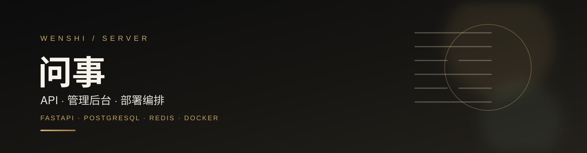
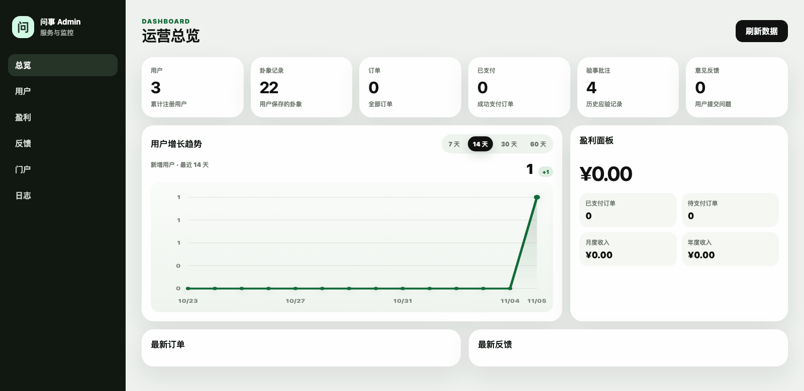
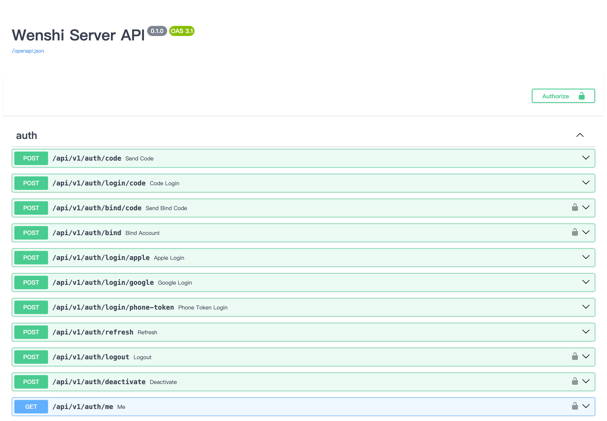
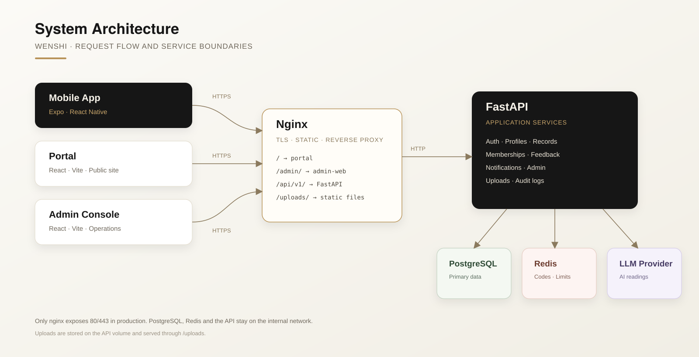
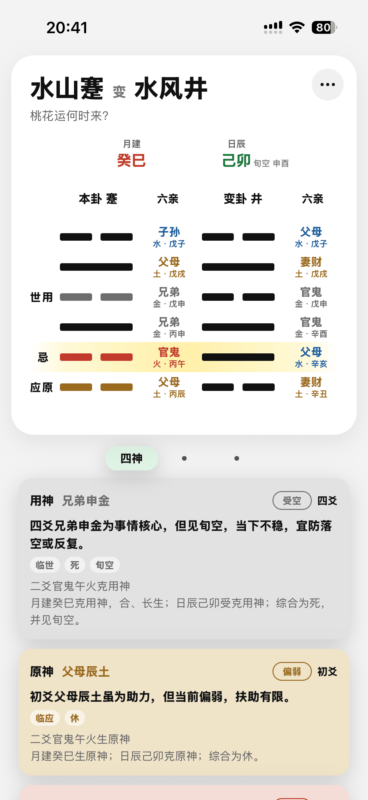
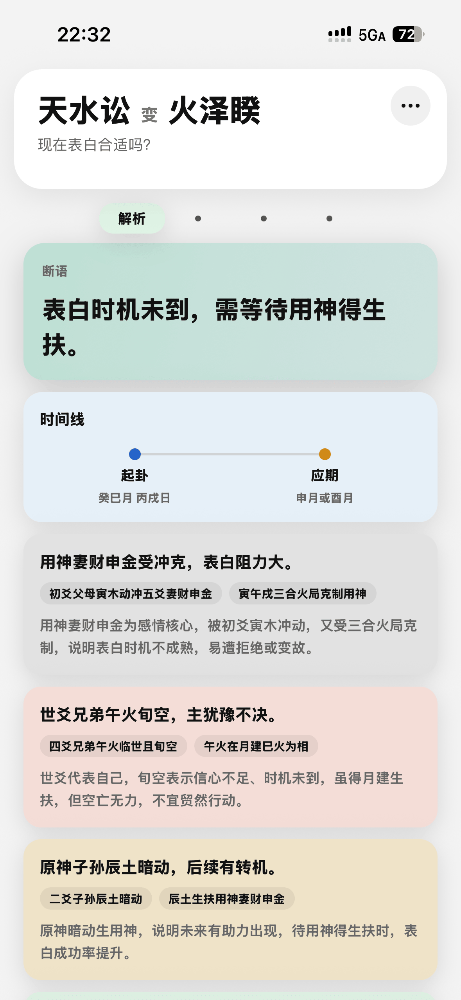

<p align="center">
  
</p>

# 问事 Server

[](https://github.com/Xuezhihengg/wenshi-server/actions/workflows/ci.yml)
[](LICENSE)
[](https://www.python.org)
[](https://fastapi.tiangolo.com)
[](https://www.postgresql.org)
[](https://redis.io)

问事的后端 API、运营管理后台与部署编排。它为移动端提供账号、档案、起卦记录、AI 解读、会员与反馈能力，并配套一个可直接使用的管理控制台。

> Wenshi Server is the open-source backend for a Liuyao (six-line divination) journaling app. It ships authentication, profiles, records, AI-assisted readings, memberships, feedback, notifications, observability and a React admin console.

<p align="center">
  
</p>

## 功能

| 模块 | 能力 |
| --- | --- |
| 账号 | 手机号 / 邮箱验证码登录，Apple、Google 登录，Token 刷新与注销 |
| 档案 | 用户资料、本人 / 家人 / 合作方档案与隐私设置 |
| 记录 | 起卦记录、收藏、验事备注、历史归档与服务端同步 |
| AI 解读 | 兼容 OpenAI 的模型接口，服务端拼装结构化上下文 |
| 会员 | 套餐、额度、权益与支付渠道抽象 |
| 反馈 | 公开反馈表单、截图上传与管理后台处理 |
| 运营 | 门户访问统计、审计日志、运行指标与日志查询 |
| 管理台 | 用户、订单、反馈、门户、日志与总览仪表盘 |

## API 文档

<p align="center">
  
</p>

## 系统架构

<p align="center">
  
</p>

| 组件 | 职责 |
| --- | --- |
| Nginx | TLS、静态资源、`/api/v1/` 反向代理与上传文件服务 |
| FastAPI | 认证、档案、记录、会员、反馈、通知与管理接口 |
| Worker | 异步任务与后台作业 |
| PostgreSQL | 业务主数据 |
| Redis | 验证码、限流、缓存与会话辅助数据 |
| Admin Web | React + Vite 运营控制台，挂载在 `/admin/` |
| Portal Web | 官网静态站点，来自独立的 `wenshi-portal` 仓库 |

生产环境只暴露 nginx 的 80 / 443；PostgreSQL、Redis 与 API 均留在内部 Docker 网络。

## 技术栈

| 层级 | 技术 |
| --- | --- |
| Web 框架 | FastAPI、Starlette、Pydantic Settings |
| 数据层 | SQLAlchemy 2（async）、asyncpg、Alembic |
| 缓存与限流 | Redis 7+ |
| 认证 | JWT、手机号 / 邮箱验证码、Apple / Google Identity Token |
| AI | OpenAI-compatible LLM provider（默认 NVIDIA NIM） |
| 可观测性 | structlog、JSON 日志、Prometheus metrics |
| 前端 | React 19、Vite 8、TypeScript 6 |
| 部署 | Docker Compose、Nginx、Let's Encrypt |

## 快速开始

### 环境要求

- Python 3.11+
- [uv](https://docs.astral.sh/uv/)
- PostgreSQL 16+
- Redis 7+
- Node.js 20.19+
- Docker 与 Docker Compose（可选）

### 方式一：Docker Compose

完整编排会从同级目录构建官网，因此先把两个仓库克隆到同一个父目录：

```bash
mkdir -p ~/code && cd ~/code
git clone https://github.com/Xuezhihengg/wenshi-server.git
git clone https://github.com/Xuezhihengg/wenshi-portal.git

cd wenshi-server
cp .env.example .env
docker compose up --build
```

启动后：

- API 文档：http://127.0.0.1:8000/docs
- 健康检查：http://127.0.0.1:8000/health
- 管理后台：http://127.0.0.1/admin/
- 官网：http://127.0.0.1/

只开发后端时，可以使用下面的本地方式，或删除 / 注释 `docker-compose.yml` 中的 `portal-web` 服务。

### 方式二：本地开发

```bash
cp .env.example .env
uv sync --extra dev

createdb -O wenshi wenshi
uv run alembic -c apps/api/alembic.ini upgrade head
uv run uvicorn app.main:app --app-dir apps/api --reload
```

管理后台：

```bash
cd admin-web
npm ci
npm run dev
```

开发环境默认使用 `mock` 验证码，验证码固定为 `123456`。默认管理员账号来自 `.env` 中的 `ADMIN_USERNAME` / `ADMIN_PASSWORD`；`.env.example` 中为 `admin@wenshi.local` / `dev-only-change-me`。

完整的本地开发说明见 [docs/DEVELOPMENT.md](docs/DEVELOPMENT.md)。

## 环境变量

完整列表见 [.env.example](.env.example)。生产环境至少要修改：

| 变量 | 说明 |
| --- | --- |
| `ENVIRONMENT` | 生产环境设为 `production` |
| `POSTGRES_PASSWORD` | 数据库强密码 |
| `JWT_SECRET` | 至少 32 位随机字符串，使用 `openssl rand -hex 32` 生成 |
| `ADMIN_USERNAME` / `ADMIN_PASSWORD` | 管理员账号与强密码 |
| `CORS_ORIGINS` | 允许的前端来源，逗号分隔，禁止通配符 |
| `PUBLIC_BASE_URL` | 对外访问地址，用于生成上传文件 URL |
| `PHONE_VERIFICATION_PROVIDER` | 生产环境不能为 `mock` |
| `EMAIL_VERIFICATION_PROVIDER` | 生产环境不能为 `mock` |
| `LLM_API_KEY` | AI 解读使用的模型服务密钥 |

当 `ENVIRONMENT=production` 时，应用会拒绝启动，如果仍在使用开发默认密钥、默认管理员密码、`mock` 验证码或通配 CORS。

### 可选集成

- **阿里云短信 / DirectMail**：配置 `ALIYUN_SMS_*`、`ALIYUN_DM_*`
- **Apple 登录**：配置 `APPLE_CLIENT_ID`
- **Google 登录**：配置 `GOOGLE_WEB_CLIENT_ID`、`GOOGLE_IOS_CLIENT_ID`、`GOOGLE_ANDROID_CLIENT_ID`
- **AI 解读**：配置 `LLM_PROVIDER`、`LLM_BASE_URL`、`LLM_MODEL` 与 `LLM_API_KEY`

## API 概览

| 前缀 | 说明 |
| --- | --- |
| `/api/v1/auth/*` | 验证码、登录、绑定、刷新、注销与第三方登录 |
| `/api/v1/profiles/*` | 用户档案与隐私设置 |
| `/api/v1/records/*` | 起卦记录、收藏与 AI 解读 |
| `/api/v1/memberships/*` | 套餐、订单与权益 |
| `/api/v1/feedback/*` | 用户反馈 |
| `/api/v1/notifications/*` | 站内通知 |
| `/api/v1/public/*` | 公开反馈与门户访问统计 |
| `/api/v1/admin/*` | 管理后台接口 |
| `/uploads/*` | 头像与反馈截图 |

启动后访问 `/docs` 查看完整 OpenAPI 文档。

### 客户端能力

<p align="center">
  
  
</p>

## 数据库

迁移使用 Alembic：

```bash
uv run alembic -c apps/api/alembic.ini upgrade head
uv run alembic -c apps/api/alembic.ini revision --autogenerate -m "describe change"
```

本地测试库只需创建一次：

```bash
createdb -O wenshi wenshi_test
```

测试需要本地 PostgreSQL 与 Redis 运行，并使用独立的 `wenshi_test` 数据库与 Redis DB 15。

## 代码检查

```bash
uv run ruff check .
uv run pytest -q
```

管理后台：

```bash
cd admin-web
npm run typecheck
npm run build
```

## 部署

生产部署使用 Docker Compose、Nginx 与 Let's Encrypt：

```bash
docker compose -f docker-compose.yml -f docker-compose.prod.yml up -d --build
```

完整的服务器初始化、DNS、HTTPS、备份与运维步骤见 [docs/DEPLOYMENT.md](docs/DEPLOYMENT.md)。

发布前请确认：

- 没有提交 `.env`、数据库文件、日志、上传文件或真实用户数据
- 已轮换所有曾经出现在开发环境中的密钥与 Token
- 已配置正式的短信、邮件、Apple / Google 登录与模型服务凭据
- `CORS_ORIGINS`、`PUBLIC_BASE_URL` 与证书域名一致

## 项目结构

```text
apps/api/              FastAPI 应用、Alembic 迁移与测试
admin-web/             React + Vite 管理后台
docs/                  开发、部署与截图
infra/                 nginx、证书与备份脚本
scripts/               开发数据脚本
docker-compose.yml     开发编排
docker-compose.prod.yml 生产覆盖配置
```

## 关联仓库

- [wenshi-app](https://github.com/Xuezhihengg/wenshi-app)：Expo / React Native 客户端
- [wenshi-portal](https://github.com/Xuezhihengg/wenshi-portal)：官网、隐私政策与反馈入口

## 安全

请不要在 Issue 中提交密钥、真实用户数据或生产环境日志。漏洞报告方式见 [SECURITY.md](SECURITY.md)。

## 贡献

欢迎提交 Issue 与 Pull Request，开始前请阅读 [CONTRIBUTING.md](CONTRIBUTING.md) 和 [CODE_OF_CONDUCT.md](CODE_OF_CONDUCT.md)。

## License

[MIT](LICENSE)。项目名称、Logo 与截图不随代码许可授权，详见 [TRADEMARKS.md](TRADEMARKS.md)。
